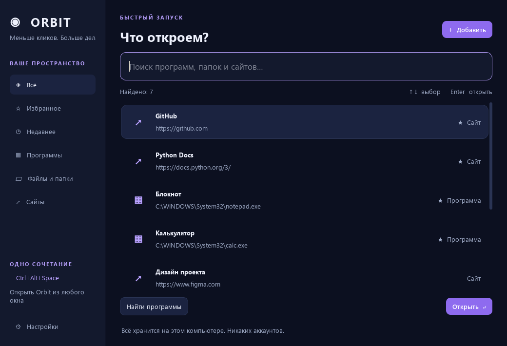
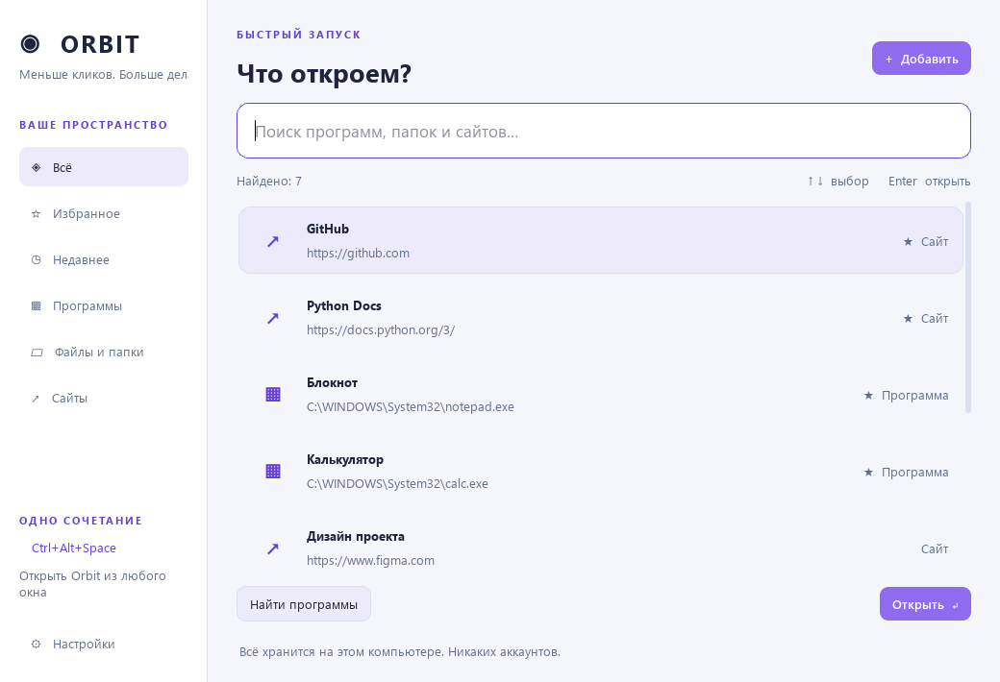
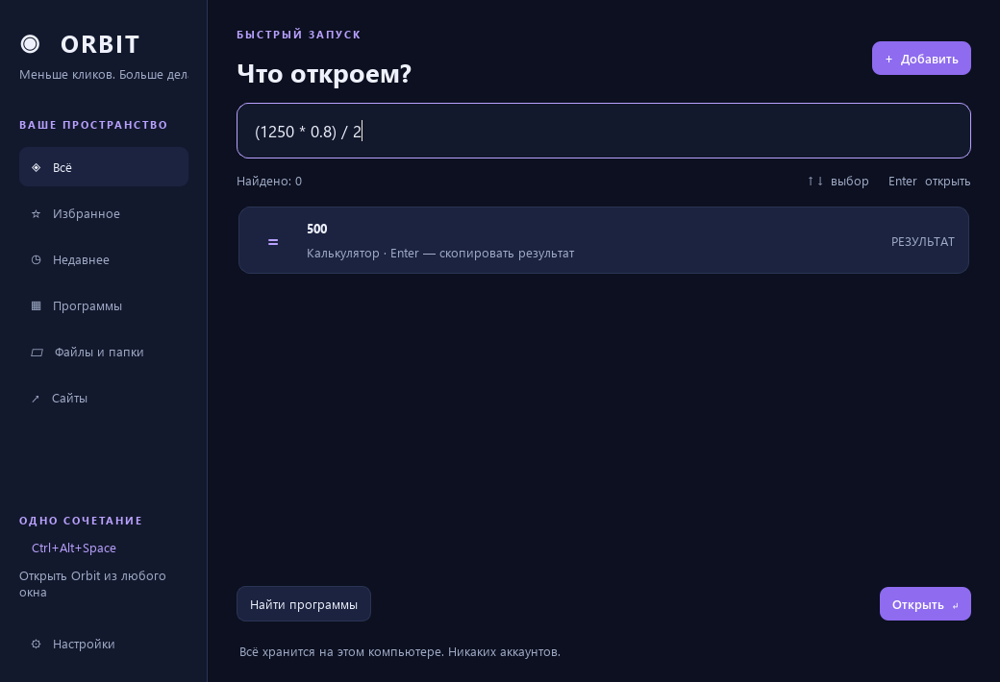

<div align="center">

# ◉ Orbit Launcher

**Всё нужное — в одном движении.**

Локальный лаунчер для Windows: программы, папки, файлы и сайты под одной горячей клавишей.

Python 3.11+ · PySide6 / Qt 6 · SQLite · Windows 10/11 · MIT



</div>

## Что умеет

- Поиск по названию и ключевым словам, неточные совпадения и исправление раскладки: `пшерги` → GitHub.
- Ручное добавление программ, файлов, папок и HTTP(S)-ссылок.
- Поиск программ по ярлыкам меню «Пуск», в отдельном потоке.
- Избранное, недавно открытые объекты, счётчик запусков и фильтры по типу.
- Глобальная горячая клавиша, значок в трее и управление с клавиатуры.
- Калькулятор: введите `(1250 * 0.8) / 2`, нажмите Enter, чтобы скопировать ответ.
- Тёмная и светлая темы, импорт и экспорт записей в JSON.
- Один экземпляр для каждого каталога данных; повторный запуск показывает открытое приложение.

## Запуск готовой сборки

Распакуйте **всю** папку `OrbitLauncher` из ZIP Windows-сборки и запустите `OrbitLauncher.exe`.
Установленный Python не нужен. Не переносите EXE отдельно от папки `_internal`.

Сборка не подписана цифровым сертификатом. Windows может показывать предупреждение о неизвестном издателе.

## Запуск из исходников

Нужен Python 3.11 или новее и Windows 10/11 x64. В PowerShell из папки проекта:

```powershell
.\setup.ps1
.\start.ps1
```

Если выполнение PowerShell-скриптов отключено, можно выполнить команды напрямую:

```powershell
py -3 -m venv .venv
.\.venv\Scripts\python.exe -m pip install -e ".[dev]"
.\.venv\Scripts\python.exe -m orbit_launcher
```

Установка скачивает зависимости из PyPI; для дальнейшей работы лаунчера интернет не нужен.
Открытие сайтов требует подключения к сети.

## Первые действия

1. Нажмите **«Найти программы»**, чтобы добавить ярлыки из меню «Пуск».
2. Добавьте свои сайты, файлы и папки через **«Добавить»**.
3. Откройте контекстное меню записи правой кнопкой: избранное, изменение, копирование адреса, удаление.
4. Вызывайте Orbit сочетанием **Ctrl+Alt+Space**. Если оно занято, выберите другое в настройках.

| Клавиши | Действие |
| --- | --- |
| Ctrl+Alt+Space | Показать / скрыть Orbit из любого окна |
| ↑ / ↓ | Выбрать результат |
| Enter | Открыть выбранный объект / скопировать ответ калькулятора |
| Ctrl+F | Перейти к поиску |
| Ctrl+N | Добавить запись |
| Escape | Скрыть в трей; без трея — свернуть |
| Ctrl+Q | Выйти полностью |

Крестик окна скрывает Orbit в трей, если трей доступен. Полный выход — через меню значка или Ctrl+Q.
Автозапуск Windows не изменяется.

## Демонстрация

```powershell
.\.venv\Scripts\python.exe -m orbit_launcher --demo
```

Демонстрация использует отдельное хранилище. Папка `C:\Projects` и файл заметок в ней — иллюстрации;
если их нет на компьютере, Orbit покажет понятное сообщение. Остальные ссылки и системные приложения настоящие.

<details>
<summary>Светлая тема и калькулятор</summary>




</details>

## Данные и ограничения

Рабочее хранилище: `%LOCALAPPDATA%\OrbitLauncher\orbit.sqlite3`.
Для демонстрации: `%LOCALAPPDATA%\OrbitLauncher-Demo`. Для другого расположения есть `--data-dir PATH`.

Приложение не отправляет поисковые запросы или список программ на сервер. Оно не читает содержимое
индексируемых документов, а при индексации ищет только ярлыки меню «Пуск».

Импорт не запускает объекты, не заменяет существующие записи и проверяет весь файл перед сохранением.
Открывайте только доверенные программы и файлы. Экспорт содержит локальные пути и может раскрывать
названия ваших папок; перед публикацией используйте демонстрационные данные.

Индекс не охватывает все приложения Microsoft Store, переносные программы и любые команды оболочки.
Их исполняемые файлы или ярлыки можно добавить вручную. Лаунчер ориентирован на Windows;
снимки Qt и основная логика могут проверяться в среде без рабочего стола.

## Разработка и проверки

```powershell
.\.venv\Scripts\python.exe -m pytest -q
.\.venv\Scripts\ruff.exe check .
.\.venv\Scripts\python.exe scripts/capture.py
.\scripts\build.ps1
```

Тесты используют временные базы. UI-тесты перехватывают запуск программ и не открывают внешние объекты.
`capture.py` рендерит настоящие Qt-виджеты с вымышленными данными без снимка рабочего стола.
GitHub Actions описан в `.github/workflows/checks.yml`; его запуск на GitHub зависит от публикации репозитория.

## Устройство

```text
src/orbit_launcher/
  app.py         запуск, демонстрация, один экземпляр
  models.py      модель и проверка записей
  storage.py     SQLite, настройки, импорт и экспорт
  search.py      ранжирование, раскладка, безопасный AST-калькулятор
  platforms.py   Windows: запуск, ярлыки, RegisterHotKey
  ui.py          интерфейс Qt
  theme.py       палитры и рисованные значки
tests/           проверки поведения и интерфейса
scripts/         снимки интерфейса и сборка Windows
```

Калькулятор обходит разрешённые узлы AST с ограничениями на размер выражения и результат;
`eval` и выполнение команд оболочки не используются.

## Разработка

Личный проект, разработанный с использованием OpenAI Codex.
Я выбрал идею, сформулировал требования к проекту и задавал направление дальнейших изменений.
Codex использовался для реализации кода, оформления интерфейса, подготовки документации и тестов.

Перед размещением на GitHub: [инструкция публикации](docs/GITHUB.md).
Источники API: [Qt for Python](https://doc.qt.io/qtforpython-6/),
[RegisterHotKey](https://learn.microsoft.com/windows/win32/api/winuser/nf-winuser-registerhotkey).

Лицензия исходного кода — [MIT](LICENSE). PySide6 и Qt распространяются под собственными лицензиями;
при распространении бинарной сборки сохраняйте вложенные уведомления Qt и выполняйте условия LGPL.
